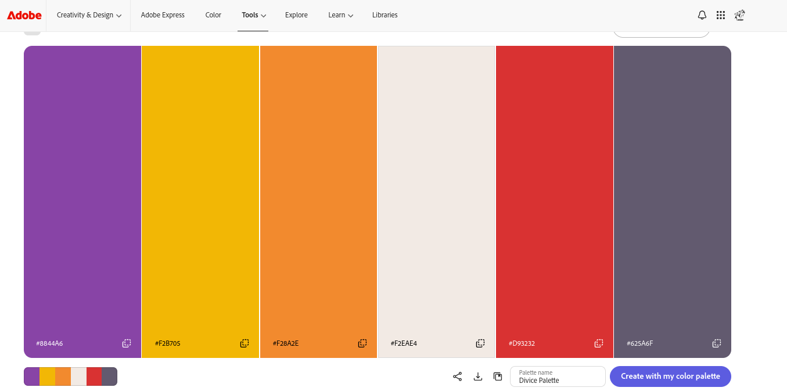

# Paleta de colores

La paleta se generó con [Adobe Color](https://color.adobe.com/create/color-wheel), extrayendo los colores del frame de la partida (`design/Frames Exportados/Digivice_page-0004.jpg`).

Enlace a la paleta: [Divice Palette en Adobe Color](https://color.adobe.com/create/color-wheel?tab=image&color-palette=8844A6%2CF2B705%2CF28A2E%2CF2EAE4%2CD93232%2C625A6F&color-palette-name=Divice+Palette)

## Cómo se usa en `css/tokens.css`

| Color de la paleta | Variable | Uso |
| :---- | :---- | :---- |
| `#625A6F` | `--color-marca` | Botón principal y foco |
| `#F28A2E` | `--color-acento` | Subrayado del nav y borde de la zona segura |
| `#F2EAE4` | `--color-mapa` | Fondo del mapa |
| `#F2B705` | `--color-aviso` | Tarjetas del tutorial |
| `#D93232` | `--orbe-vaccine` | Orbes Vaccine |
| `#8844A6` | `--orbe-virus` | Orbes Virus |

## Ajustes para accesibilidad

Algunos colores no llegan al contraste AA (4.5:1) cuando se usan como texto, así que se oscurecieron:

| Original | Variable | Motivo |
| :---- | :---- | :---- |
| `#F28A2E` | `--color-acento-texto: #964d05` | Texto naranja, como "Zona segura" |
| `#D93232` | `--color-derrota: #b71c1c` | Título "Fin del juego" sobre el modal |

El texto va en negro (`#000`) y negro suave (`#333`), y las superficies en blanco y grises claros. Los orbes Data (`#42a048`) y Free (`#4fc3f6`) salen del diseño. Los orbes nunca llevan texto encima y siempre van junto al nombre del tipo de data.
